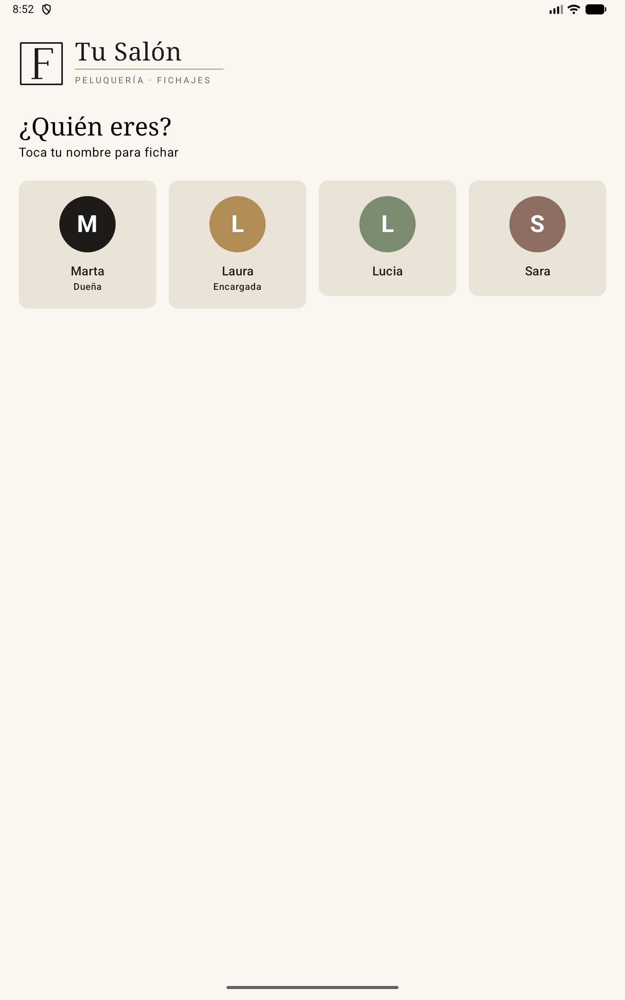
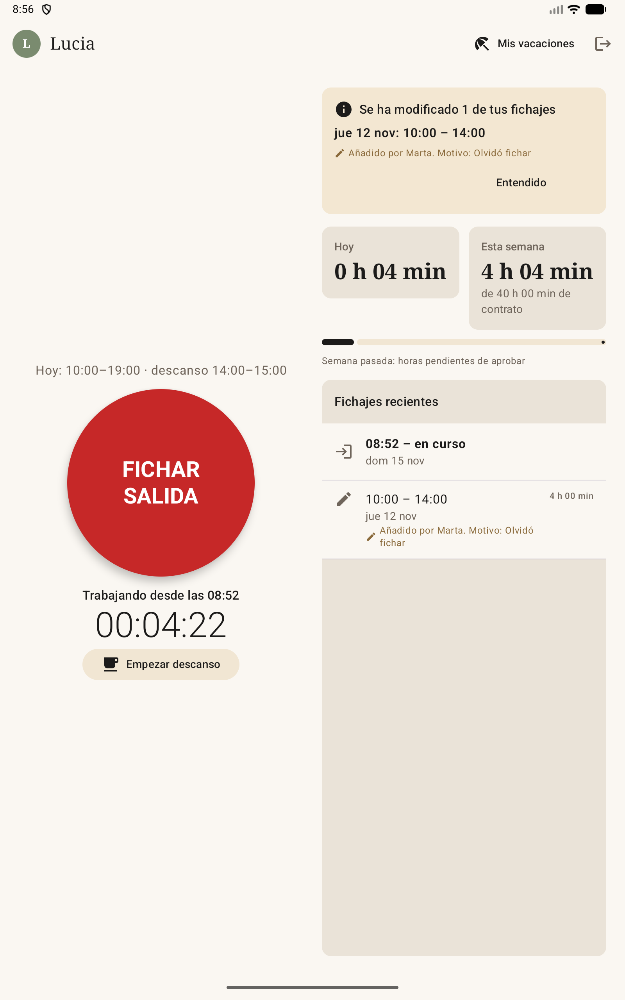
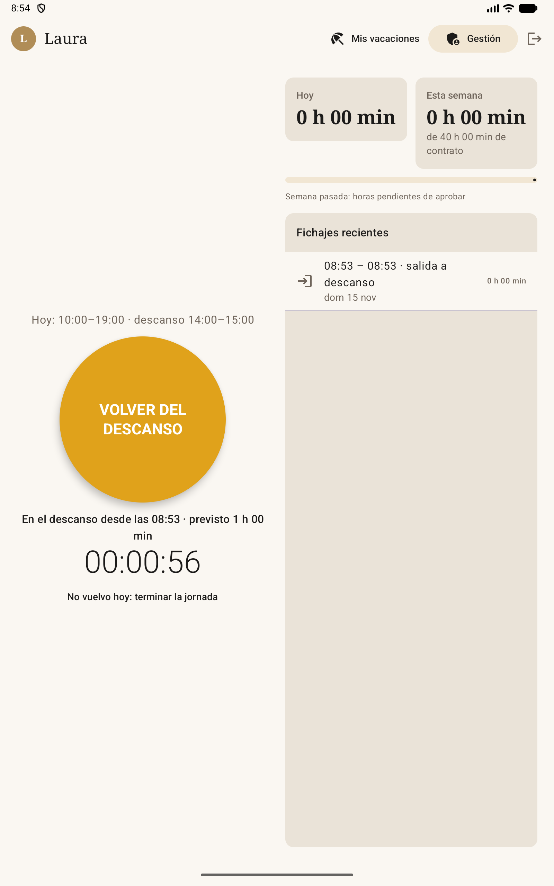
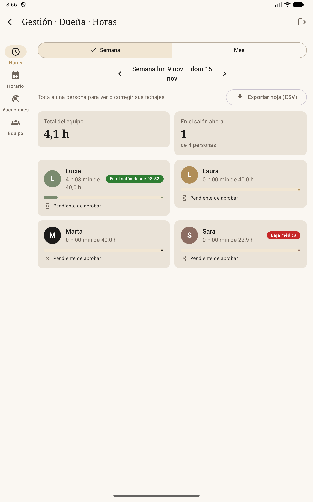
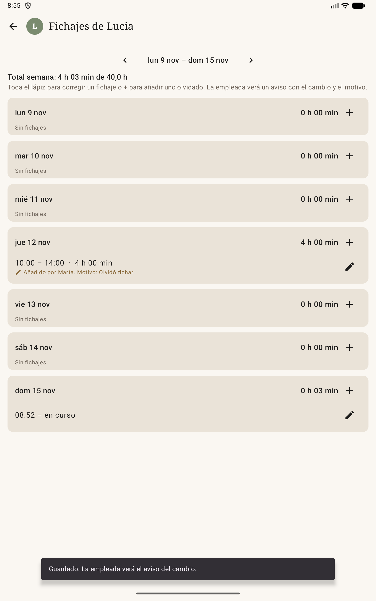
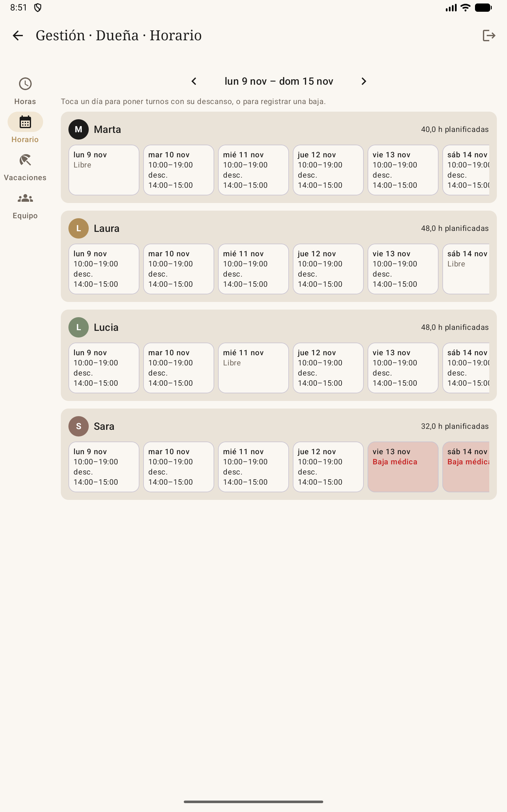
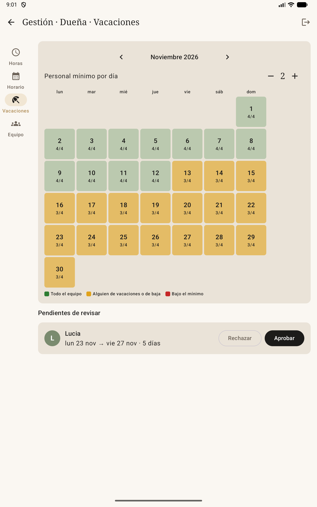

# Fichapp · Control horario para un salón de peluquería

App Android para llevar el **registro de jornada, los horarios, los descansos, las bajas y las vacaciones** de un pequeño negocio local: un salón de peluquería con su dueña, alguna encargada y varias empleadas. Funciona en una **tablet compartida en modo quiosco**: cada persona entra con su PIN, ficha y la sesión se cierra sola.

Nació como un proyecto real para un salón de barrio, con una necesidad concreta: cumplir el registro horario obligatorio (art. 34.9 del Estatuto de los Trabajadores, RD-ley 8/2019) sin pagar una suscripción ni depender de internet.

**Stack:** Kotlin · Jetpack Compose (Material 3) · MVVM · Coroutines/Flow · Hilt · Room · KSP · JUnit

## Capturas

Versión demo en una tablet, con datos de ejemplo.

<table>
  <tr>
    <td align="center"><br><sub>Entrada: cada persona toca su nombre y pone su PIN</sub></td>
    <td align="center"><br><sub>Fichar, con el turno de hoy y el aviso de una corrección</sub></td>
    <td align="center"><br><sub>En el descanso: el botón pasa a ámbar</sub></td>
  </tr>
  <tr>
    <td align="center"><br><sub>Panel de horas del equipo, con bajas y aprobación semanal</sub></td>
    <td align="center"><br><sub>Corregir o añadir fichajes, con auditoría</sub></td>
    <td align="center"><br><sub>Horario semanal con descansos y una baja médica</sub></td>
  </tr>
  <tr>
    <td align="center"><br><sub>Personal disponible por día y solicitudes pendientes</sub></td>
    <td></td>
    <td></td>
  </tr>
</table>

---

## Funcionalidades

### Para el equipo
- **Fichar en tres toques**: nombre, PIN de 4 cifras y botón grande. **Verde** para entrar, **rojo** para salir y **ámbar** para volver del descanso.
- **Descansos**: el horario define el descanso de cada turno y la empleada ficha su inicio y su vuelta. El descanso no cuenta como tiempo trabajado y el cronómetro avisa si se pasa del previsto.
- **Resumen personal**: turno de hoy, horas de hoy y de la semana frente al contrato, estado de aprobación de la semana anterior e historial reciente.
- **Vacaciones**: solicitud con selector de fechas y saldo de días disponibles del año.
- **Transparencia**: si gestión corrige un fichaje, la empleada ve un aviso con la hora original, la nueva, quién la cambió y el motivo.

### Para la dueña y la encargada
- **Panel de horas** por semana o mes: quién está ahora en el salón, horas frente al objetivo (que descuenta los días de baja), total del equipo y alertas de fichajes abiertos más de 14 h.
- **Corrección de fichajes** con auditoría completa: nunca se borra lo fichado y la primera corrección guarda las horas originales.
- **Aprobación semanal de horas**: se guardan los minutos aprobados. Si alguien corrige después un fichaje de esa semana, la aprobación pasa a *"Cambió tras aprobarse"*.
- **Horario semanal** con turnos, descansos y **bajas** (abiertas hasta el alta), con las vacaciones aprobadas visibles.
- **Vacaciones**: calendario mensual de personal disponible (las bajas también restan) y aviso antes de aprobar si el salón queda por debajo del mínimo configurado.
- **Exportación CSV** de la hoja de horas, lista para Excel (`;`, decimales con coma, UTF-8 con BOM), con el detalle de cada tramo, las correcciones y un resumen por persona.

### Roles y seguridad

| Acción | Dueña | Encargada | Empleada |
| --- | --- | --- | --- |
| Fichar, pedir vacaciones | ✔ | ✔ | ✔ |
| Ver y corregir horas, aprobar semanas | ✔ | ✔ (nunca las suyas) | — |
| Horario y bajas | ✔ | ✔ (nunca lo suyo) | — |
| Aprobar vacaciones, personal mínimo | ✔ | — | — |
| Altas, bajas, roles, PIN, exportar, ceder el control | ✔ + contraseña maestra | — | — |

- **Permisos comprobados dos veces**: la UI oculta lo que no toca y los repositorios rechazan la operación (`PermissionChecker` + `domain/auth/Permissions`), aunque alguien se salte la interfaz.
- **PIN** y **contraseña maestra** guardados como hash **PBKDF2WithHmacSHA256** con salt por persona. Con 5 fallos seguidos se bloquea el teclado.
- **Contraseña maestra con "sudo"**: se pide para acciones delicadas y no se vuelve a pedir durante 5 minutos.
- **Código de recuperación** de un solo uso que se enseña una vez, y **cesión del control** a otra dueña en una transacción (nunca puede quedar el salón sin dueña o con dos).
- **Configuración inicial en dos pasos**: quien instala la app pasa la tablet a la dueña para que elija sus credenciales. No hay contraseñas por defecto en el código.
- **Modo quiosco**: sesión solo en memoria, cierre automático tras fichar y por inactividad, y cierre al salir de la app.

---

## Arquitectura

```
com.salon.fichajes
├── core/
│   ├── time/        Periods (día/semana/mes → TimeRange en Instant), WorkedTime, tickerFlow
│   ├── format/      Formateo de duraciones, horas y fechas en español
│   └── security/    PinHasher (PBKDF2 + salt), PasswordRules, RecoveryCode
├── domain/
│   ├── model/       Employee, ClockEntry, WorkState, Shift, Absence, WeekApproval, VacationRequest…
│   ├── repository/  Interfaces (frontera con la persistencia)
│   ├── auth/        Permissions: quién puede hacer qué
│   ├── clock/       CorrectionRules
│   ├── hours/       Objetivo de horas con bajas y estado de aprobación semanal
│   ├── staffing/    Personal disponible por día y aviso de mínimo
│   └── vacation/    Saldo anual de vacaciones
├── data/
│   ├── local/       AppDatabase (v4), Converters, entity/, dao/
│   ├── repository/  Implementaciones Room + PermissionChecker
│   ├── export/      TimesheetCsv + TimesheetExporter (Storage Access Framework)
│   └── settings/    Ajustes del salón
├── di/              Módulos Hilt (BD, Clock, binding interfaz → implementación)
├── session/         SessionManager e InactivityPolicy
└── ui/              Compose: setup, login, employee (fichar, vacaciones), admin (horas, fichajes,
                     horario, vacaciones, equipo), security, theme, navigation
```

Flujo de datos: **Room → DAO (`Flow`) → repositorio (mapea a dominio) → ViewModel (`combine` / `flatMapLatest` → `StateFlow<UiState>`) → Composable (`collectAsStateWithLifecycle`)**. Los eventos de un solo uso (snackbar, vibración) van por un `Channel`.

### Decisiones de diseño

- **El fichaje es un tramo** (`clockIn`, `clockOut?`), no dos eventos sueltos: un tramo abierto significa "trabajando" y no puede haber dos salidas seguidas. Un descanso es un tramo cerrado con `endedForBreak = true`.
- **Fichar es atómico**: `ClockEntryDao.toggle()` es una `@Transaction`. Si un tramo lleva más de 14 h abierto o la hora del dispositivo ha ido hacia atrás, no se cierra solo (`NeedsAdminReview`).
- **Tiempo en `Instant` (UTC)**, convertido a hora local solo al mostrarlo. Los periodos se calculan con `atStartOfDay(zone)`, así que los cambios de hora (días de 23 h o 25 h) salen bien. `java.time.Clock` se inyecta: ningún `Instant.now()` y tests deterministas.
- **`WorkedTime.between(entries, range, now)`** suma el solape de cada tramo con el periodo, reparte los tramos que cruzan medianoche y cuenta los abiertos hasta `now`.
- **Nunca se borran fichajes ni personas**: FKs `RESTRICT` y bajas lógicas, porque el registro debe conservarse 4 años.
- **Room primero, detrás de interfaces**: funciona sin conexión y sin coste. Para migrar a Firestore basta con nuevas implementaciones de `domain/repository` y cambiar los bindings de `di/`. El plan está más abajo.
- **Migraciones sin pérdida de datos**: los esquemas se exportan en `app/schemas` y cada versión (v1 → v4) tiene su `AutoMigration`.

---

## Cómo ejecutarlo

Requisitos: Android Studio Narwhal (2025.1.3) o posterior. Funciona en móvil, pero está pensada para tablet (minSdk 26, Android 8.0).

1. Abre la carpeta en Android Studio y espera a que sincronice Gradle.
2. Elige un emulador o dispositivo y pulsa **▶ Run**.

Desde la terminal:

```bash
./gradlew installDemoDebug
```

```bash
./gradlew test
```

En el primer arranque, la app guía la creación de la cuenta de la dueña (PIN, contraseña maestra y código de recuperación). Desde *Gestión → Equipo* se da de alta al resto.

**Versiones:** AGP 8.13.2 · Gradle 8.13 · Kotlin 2.2.21 · KSP 2.2.21-2.0.5 · Hilt 2.57.2 · Room 2.8.3 · Compose BOM 2025.10.01 · compileSdk/targetSdk 36.

### Marca personalizada para cada salón

La app tiene dos variantes (*product flavors*):

- **`demo`** (por defecto): marca genérica *Fichapp*. Es la que está en este repositorio.
- **`salon`**: toma el nombre, el lema y el monograma de `app/src/salon/res` (`values/strings.xml` con `app_name`, `salon_name` y `salon_tagline`, y `drawable/ic_brand_monogram*.xml`). Esa carpeta está en `.gitignore`, así que la identidad de un cliente real nunca se publica. Si no existe, la variante sale igual que `demo`.

En Android Studio se cambia en *Build Variants* (`salonDebug`), y desde la terminal con `./gradlew installSalonDebug`. Los colores y la tipografía están en `ui/theme/Theme.kt`.

---

## Tests

`./gradlew test` ejecuta **53 tests unitarios** de JVM, sin emulador:

| Test | Qué cubre |
| --- | --- |
| `WorkedTimeTest` | Tramo que cruza medianoche, tramo abierto, fuera de rango, bordes, reloj atrasado, jornada partida |
| `PeriodsTest` | Semana de lunes a domingo, semana con cambio de hora (167 h), febrero bisiesto |
| `WorkStateTest` | Trabajando / en el descanso / descanso de ayer sin volver; horas planificadas sin el descanso |
| `HoursRulesTest` | Objetivo de horas con bajas (también abiertas), aprobación semanal y cambios posteriores |
| `StaffingTest` | Personal disponible con vacaciones y bajas, aviso de mínimo, saldo de vacaciones entre años |
| `CorrectionRulesTest` | Validación de correcciones (motivo, futuro, más de 16 h, día siguiente) |
| `PermissionsTest` | Dueña / encargada / empleada, y que la encargada nunca gestiona lo suyo |
| `MasterPasswordTest` | Reglas de contraseña, código de recuperación y hash con salt |
| `InactivityPolicyTest` | Cuenta atrás y tiempos por rol |
| `TimesheetCsvTest` | Exportación: detalle, auditoría, tramos nocturnos y abiertos, resumen, escape |

---

## Datos en el dispositivo y migración a Firestore

**Por qué Room:** funciona sin wifi, no cuesta nada y no exige mantener cuentas ni reglas de seguridad mientras se valida la app en el negocio. Las consultas por rango (`clockIn < :to AND (clockOut IS NULL OR clockOut > :from)`) van indexadas.

**Riesgos asumidos y cómo se mitigan:**
- *Pérdida o rotura de la tablet*: exportación CSV de la hoja de horas como copia (pendiente: recordatorio mensual con WorkManager). `allowBackup` está desactivado para que los datos no acaben en copias sin control.
- *Manipulación de la hora*: hora automática de red y fijación de la app (Lock Task Mode). La app detecta saltos hacia atrás y los manda a revisión.

**Plan de migración a Firestore:** colecciones por entidad con IDs `String`; `serverTimestamp()` como hora autoritativa; `runTransaction` para fichar (mismo contrato `ClockResult`); Firebase Auth con *custom claims* por rol y reglas que impidan borrar fichajes o editar los propios; caché offline de Firestore; un exportador puntual Room → Firestore en lotes; y `callbackFlow` sobre `addSnapshotListener` para que los repositorios sigan devolviendo `Flow`.

---

## Próximos pasos

- Recordatorio mensual para exportar la hoja de horas.
- Tests instrumentados de DAOs y migraciones (`MigrationTestHelper`) y tests de ViewModels con `Clock.fixed`.
- Editar los datos de una persona (horas de contrato, días de vacaciones).
- Anular un tramo creado por error sin borrarlo.
- Festivos y días de cierre en el calendario de vacaciones.
- Lock Task Mode como *device owner* en la tablet del salón.

---

Proyecto personal de [@eduardobj1905](https://github.com/eduardobj1905).
